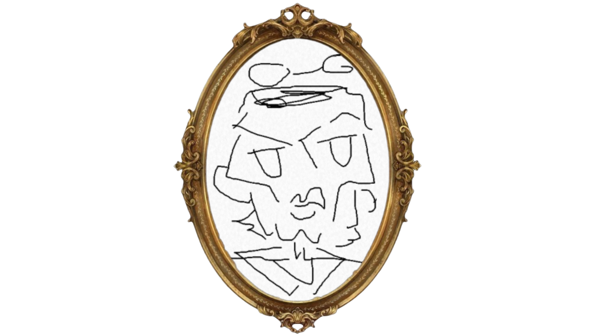

# Winter-Game-Jam-2026
A 2 day game jam made between 4 university friends in `Unity 6.3.23f1` with the theme 'Frankenstein'.
Version control was handled on Unity DevOps VC, this repository contains the final uploaded project files during submission.

https://rascalrosey.itch.io/frankencards

<h1 align="center">"IT'S A VICE!"</h1>

Victor Frankenstein has gambled away his fortune, his castle and his dignity! He's being sued by Dracula for using his likeness in the deck. No longer can he call himself Victor. So he worked late, in the lab one night, before his eyes was an eerie sight, for his gambling monster from his slab began to rise and to Victors delight he began to **gamble**.

FrankenCard is a turn based card game where you split and merge cards together to defeat gambling Frankenstein to win back your dignity.

**Split Cards** - Right Click
**Merge and Play cards** - Left Click

Ethan Holden
Marc Vance
Anthony Hood
Elliot Codling

